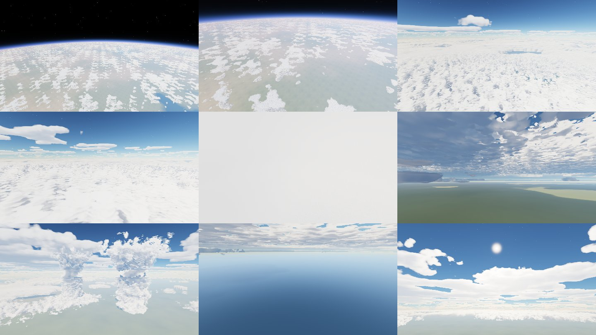

# Orbital Descent

A physics-driven mobile game for Android, built with **Unity 6**. You guide a reentry probe from orbit
to a small landing zone: plan the release, survive the plasma of entry, fight the wind through
the cloud layers, deploy the parachute at the right moment, and use the engine for a soft
touchdown.

> **Status: written and tested outside Unity. It has not been opened in the Unity editor or run on a phone yet.**
> Unity could not be installed in the environment this was built in. The simulation is tested
> headless with .NET (42 tests). The Unity scripts compile against Unity's reference API, and the
> shaders were type-checked and rendered in a WebGL preview. The first editor run will probably need
> small fixes. See [docs/STATUS.md](docs/STATUS.md) for exactly what was verified and how.



*The atmosphere and volumetric-cloud shader (the same HLSL the game uses), rendered by the WebGL preview harness in `tools/ShaderPreview`.*

## Build the Android APK

You need a computer with about 15 GB free (Windows, macOS or Linux).

1. **Install Unity Hub** from <https://unity.com/download>, then sign in. A free Personal licence is fine.
2. **Install Unity 6000.0 LTS** in Hub: *Installs → Install Editor → Unity 6 (6000.0.x LTS)*. Tick
   **Android Build Support**, and under it **OpenJDK** and **Android SDK & NDK Tools**.
   The project was written against `6000.0.23f1`, but any later 6000.0.x patch release should work.
3. **Get the project**: `git clone https://github.com/hawnji/OrbitalDecent.git`
   (or download the ZIP from GitHub and unzip it).
4. **Open it**: in Hub choose *Projects → Add → Add project from disk* and pick the cloned folder.
   The first import takes a few minutes. When it finishes, the project configures itself for Android:
   it sets IL2CPP ARM64, Linear colour, landscape orientation, the Input Manager and the `Main` scene.
   You can re-run this any time from the menu **Orbital Descent → Configure Project for Android**.
   If Unity asks to restart because the input handling changed, say yes.
5. **Try it in the editor**: open `Assets/Scenes/Main.unity` and press **Play**. The game builds its
   whole scene from code, so the scene is meant to be empty. The keyboard controls are listed below.
6. **Build the APK**: choose **Orbital Descent → Build Android APK**. Unity switches to the Android
   platform if needed, and the APK is written to `Builds/Android/OrbitalDescent.apk`.
   For Google Play, use **Orbital Descent → Build Android App Bundle (AAB)** instead.
7. **Install it on your phone**: turn on *Developer options → USB debugging*, connect the phone, then run
   `adb install -r Builds/Android/OrbitalDescent.apk`. You can also copy the APK to the phone and open
   it there, after allowing installs from that app. Another option is
   *File → Build Profiles → Android → Build And Run*.

Headless build, for CI or the command line:

```
<Unity> -batchmode -quit -projectPath . -buildTarget Android \
        -executeMethod OrbitalDescent.EditorTools.BuildAndroid.BuildApk [-aab] [-development]
```

Requirements: Android 8.0 (API 26) or newer, 64-bit ARM, and Vulkan or OpenGL ES 3.0.

## Controls

| Action | Touch | Keyboard |
| --- | --- | --- |
| Steer: lean so the predicted touchdown moves | Drag anywhere on the lower-left of the screen (floating stick) | WASD / arrows |
| Engine | Hold **BURN** | Space |
| Parachute deploy / cut | **CHUTE** | C |
| Strong stabilise (stop tumbling) | Hold **STAB** | X |
| Stability assist on/off | **SAS** | Q |
| Shield heater (de-icing) | **HEAT** | H |
| Precision boost (Phantom only) | Hold **BOOST** | Left Shift |
| Reboot avionics after a lightning strike | **REBOOT** (appears when needed) | R |
| Camera: chase / close / cinematic | **CAM** | V |
| Time warp x1 / x2 / x4 (above 25 km, no warnings) | **WARP** | T |
| Pause | **II** or the Android back button | Esc / P |

Optional tilt steering and inverted vertical steering can be turned on in Settings.

## What is in the game

- **Physics.** Inverse-square gravity on a round planet and the US Standard Atmosphere 1976.
  Aerodynamic forces act on the air-relative velocity: axial and normal coefficients, angle of
  attack and crossflow. Steering uses finite torque from fins, which need dynamic pressure, and RCS,
  which uses fuel; both have actuator lag. The model also covers static stability and damping,
  Sutton-Graves convective heating with a heat-shield temperature, ice accretion, structural
  g-limits, a parachute with deploy interlocks, a descent engine, and swept contact detection.
  Everything runs at a fixed 120 Hz step in double precision. See [docs/PHYSICS.md](docs/PHYSICS.md).
- **Ten hazards.** Wind shear, turbulence, lightning (static build-up, strike, avionics outage,
  reboot), EM interference (navigation noise and input delay), plasma blackout (from the real heat
  flux), oscillation, icing, dense cloud (visibility), terrain and structural loads.
- **Four probes.** **Dart** is light and nimble. **Hammer** is heavy and fast. **Phantom** is a
  precision lander with a boost reserve. **Wildcard** is a biconic lifting body.
- **Six missions** with briefings, three-star rules, a per-mission objective and saved best results:
  First Fall, Crosswind, Cumulus Field, Storm Front, Highlands, and Blackout Recovery (a drifting
  ship at sea).
- **Release planning.** Before release you adjust heading and entry angle and see the predicted
  touchdown. During flight a live trajectory predictor runs the same physics.
- **HUD.** Log-scale altitude bar with cloud, parachute and zone bands. Speed panel with history
  graph, Mach, g and dynamic pressure. Heading-up navigation scope with zone rings, predicted impact,
  uncertainty and wind. Distance, miss and time to impact. Authority, stability, heat, hull, fuel, ice
  and battery bars. Hazard banners with disruption timers. On-screen zone and impact markers.
- **Visuals.** Physically based single-scattering sky and aerial perspective, from space down to the
  ground. Ray-marched volumetric clouds you can fly into, using the same density function as the
  physics. Storm towers with anvils, lightning, plasma sheath, engine plumes, ionised trail, speed
  streaks, a terrain patch blended into an analytic planet, and an ocean with sun glint.
- **Audio.** Every sound is synthesised at start-up: wind roar from dynamic pressure, plasma
  crackle, engine, RCS, space drone, alerts and thunder. Master, effects, alerts and ambience each
  have their own volume.
- **Mobile.** Touch controls with multi-touch, safe-area aware HUD with an extra margin option and
  HUD scale, metric or imperial units, reduced shake and reduced motion/flashing options. Three
  quality tiers (render scale, cloud resolution and steps, shadows, frame-rate target) with automatic
  first-run detection.

## Repository layout

```
Assets/OrbitalDescent/Core/       Engine-independent simulation (no UnityEngine references)
Assets/OrbitalDescent/Runtime/    Unity views: renderer, probe, terrain, camera, FX, audio, HUD, menus
Assets/OrbitalDescent/Editor/     Project setup and Android build menu / batch entry point
Assets/OrbitalDescent/Tests/      NUnit edit-mode tests (run in Unity or with dotnet)
Assets/Resources/Shaders/         ODAtmosphereCore.hlsl (shared) + Unity shaders
tools/CoreTests/                  Runs the tests with dotnet (no Unity needed)
tools/CompileCheck/               Compiles all Unity C# against Unity reference assemblies
tools/ShaderCheck/                Type-checks every shader pass with glslang
tools/ShaderPreview/              Renders the shared HLSL in headless Chromium (WebGL2)
tools/SimTool/                    Autopilot campaign, single-run traces, benchmarks, data export
docs/                             Physics, testing, performance and status notes
```

## Tests and checks

```
dotnet test tools/CoreTests -c Release           # 42 physics and gameplay tests
dotnet build tools/CompileCheck -c Release       # all Unity C# against Unity's API
python3 tools/ShaderCheck/check.py               # every shader pass (needs glslang-tools)
dotnet run --project tools/SimTool -c Release -- campaign   # autopilot flies every mission/probe
```

In Unity, the same tests run from *Window → General → Test Runner → EditMode*.
See [docs/TESTING.md](docs/TESTING.md) for what each test proves.
